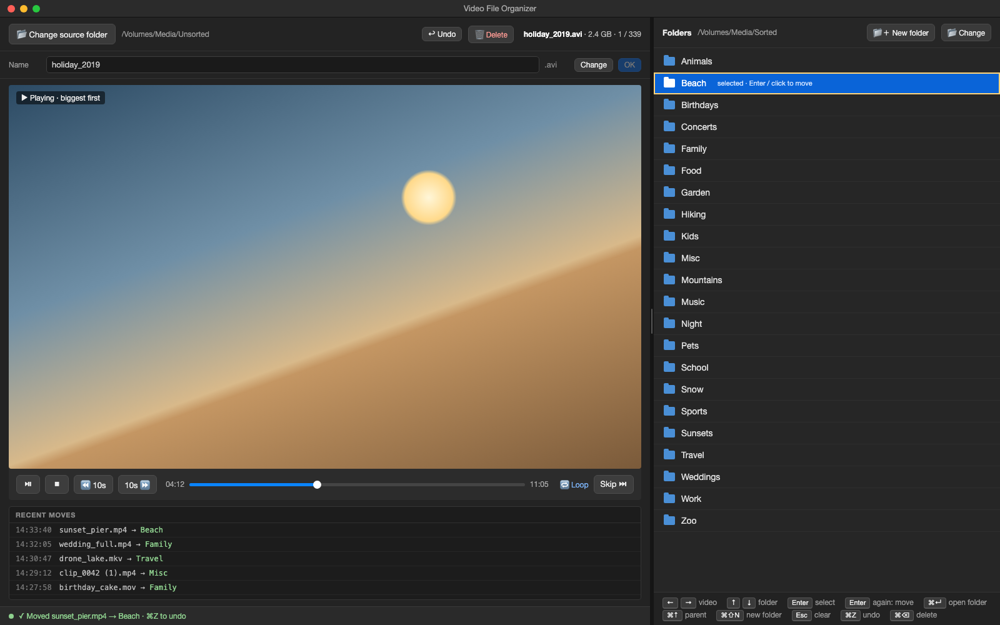

# Video File Organizer

A macOS desktop app for sorting a large number of videos into folders. Watch a
video on the left, pick a folder on the right, and the video is moved there.



- Plays MP4, AVI (Xvid/DivX), MKV, MOV, WMV and more, with nothing else to install.
- Videos play biggest first and replay until you stop, skip or move them.
- The whole flow works from the keyboard: **← / →** to pick a video, **↑ / ↓** to pick a folder,
  **Enter, Enter** to move.
- **Undo** (⌘Z) brings back the last moved or deleted video. **Delete** (⌘⌫, press twice)
  moves a video to the macOS Trash.
- Files are never overwritten or permanently deleted. Every move is checked, and recorded in `moves_log.txt`.

The full specification is in [REQUIREMENTS.md](REQUIREMENTS.md).

## Requirements

- macOS 13 or later (developed on macOS 13.7, Intel).
- **Python 3.14.** PySide6 doesn't support Python 3.15 yet, so the default `python3`
  on this Mac won't work. Install 3.14 with `brew install python@3.14` if it's missing.

## Run

### From Finder (double-click)

Build the app once from Terminal:

```sh
./make_app.sh
```

This creates **`Video File Organizer.app`** in the project folder. Double-click it in Finder,
or drag it to the Dock or to Applications. It shows its own name and icon in the Dock and
menu bar.

- The app runs the code in this folder, so code changes apply the next time you open it.
  Run `./make_app.sh` again only if you move or rename the project folder.
- The first time you choose a folder in Documents, Desktop, Downloads or on an external
  drive, macOS asks whether "Video File Organizer" may access it. Click **Allow**.
- With no Terminal, the app's output and errors go to
  `~/Library/Logs/Video File Organizer.log`.
- The `.app` contains this computer's project path, so it's in `.gitignore`. Build it on
  each computer.

### From Terminal

```sh
./run.sh
```

The first run creates a `.venv` folder and installs PySide6 (about 1 minute). After that it
starts right away.

To set it up by hand instead:

```sh
python3.14 -m venv .venv
.venv/bin/pip install -r requirements.txt
.venv/bin/python -m fileorganizer
```

## How to use it

1. **Change source folder** (top left): the folder with the videos to sort.
   Only videos directly inside it are listed; subfolders aren't searched.
2. **Change** (top right): the folder that contains your destination folders.
3. Pick a folder: click it once, or move to it with **↑ / ↓** and press **Enter**.
   It turns blue and the status bar asks you to confirm.
4. Click it again or press **Enter** again: the video moves there, and the next video starts.
   A double-click does steps 3 and 4 at once.
5. The folder **stays selected**, so the next video needs only one click or one Enter to go
   to the same folder. Press **Esc** to clear the selection.

| Key | Action |
|-----|--------|
| **→** / **←** | Next video (smaller) / previous video (bigger) |
| **↓** / **↑** | Move the folder cursor (yellow outline) |
| **Enter** | First press selects the folder, second press moves the video |
| **Esc** | Cancel a pending delete, clear the folder selection, or cancel a rename |
| **⌘Z** | Undo the last move or delete |
| **⌘⌫** | Delete: press once to ask, again to move the video to the Trash |

**Undo:** the **Undo** button (top bar) or **⌘Z** brings back the most recent move or delete.
The video returns to the source folder with its original name and plays again. Press it
again to go further back. The history covers the current source folder only and is cleared
when you choose another one.

**Delete:** the **Delete** button (top bar) or **⌘⌫** turns red and asks for confirmation in
the status bar. Press it again to move the video to the macOS Trash. Esc, 5 seconds without
confirming, or any other action cancels it. Nothing is ever deleted permanently, and Undo
brings it back from the Trash.

**Rename:** press **Change** next to the name, type the new name, then **OK** or Enter.
Esc cancels. The extension is kept, and an existing file is never overwritten.

**Settings:** the last source and destination folders and the divider position are
remembered between launches (stored by Qt in `~/Library/Preferences`).

## Move log

Every successful move is added to `moves_log.txt` in the project folder, one line per move.
Undo and Delete are moves too: back to the source folder, or into the Trash.

```
2026-11-12 14:32:05<TAB>/Volumes/Media/Unsorted/a.mp4<TAB>/Volumes/Media/Sorted/Beach/a.mp4<TAB>1234567
```

Lines are never removed. The file holds full paths of your files, so it's in `.gitignore`.

## Tests

```sh
.venv/bin/pip install -r requirements-dev.txt
.venv/bin/python -m pytest
```

The GUI tests run the real window offscreen (nothing appears on screen) and use real
videos that are generated with `ffmpeg` (`brew install ffmpeg`). Without ffmpeg those
tests are skipped.

## Project layout

```
fileorganizer/
  app.py            entry point (python -m fileorganizer)
  main_window.py    app state, keyboard shortcuts, move and rename flow
  fileops.py        listing, moving, renaming, Trash checks (no Qt; easy to test)
  trash.py          moves a file to the macOS Trash (QFile.moveToTrash)
  icon.py           the app icon, drawn in code
scripts/            setup_venv.sh, launcher.sh and make_icon.py, used by run.sh and make_app.sh
make_app.sh         builds "Video File Organizer.app" for double-clicking in Finder
  movelog.py        moves_log.txt
  theme.py          dark theme
  widgets/          player panel, folder panel, log panel, status line
tests/              unit tests and offscreen GUI tests
REQUIREMENTS.md     the specification (requirement IDs like M-12a are used in the code)
ui-mockup.png       the mockup
```

## Troubleshooting

- **`No matching distribution found for PySide6`**: the venv was made with Python 3.15.
  Delete `.venv` and run `./run.sh` again; it uses `python3.14`.
- **The app doesn't open from Finder**: look at `~/Library/Logs/Video File Organizer.log`.
  If you moved the project folder, run `./make_app.sh` again.
- **A video won't play**: the status bar shows the error. Press → or Skip to go on.
  Qt's FFmpeg backend plays nearly everything. If a specific file still fails, check it
  with `ffprobe <file>`.
